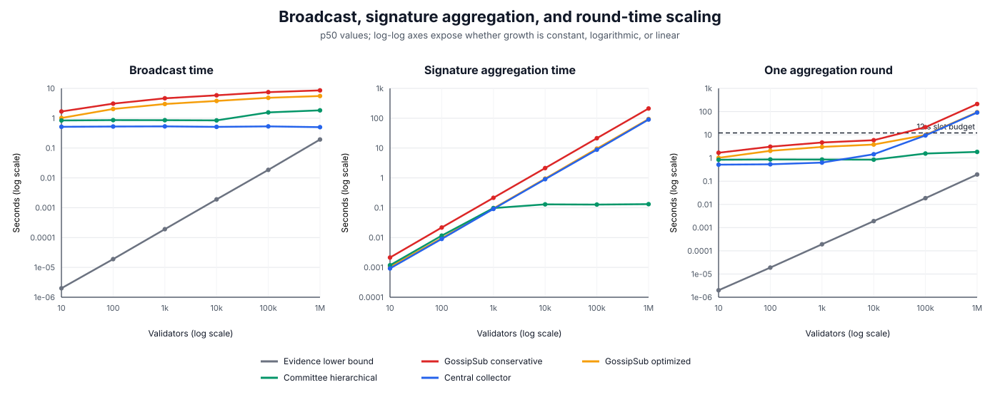
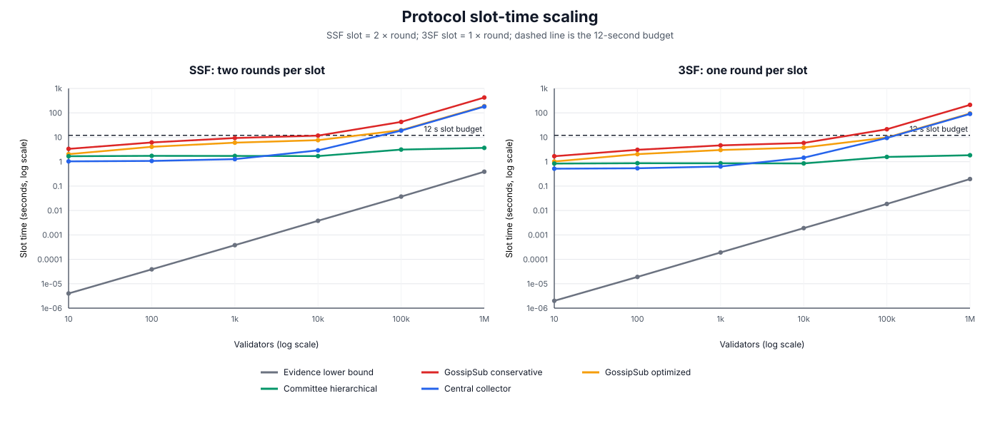
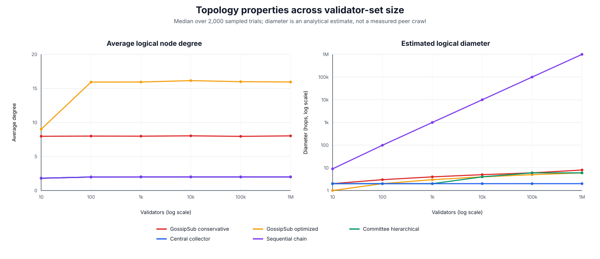

# Ethereum Fast-Finality Aggregation Experiments

This repository contains a reproducible Monte Carlo sensitivity study of
single-slot finality (SSF) and three-slot finality (3SF). The study now makes
the topology assumptions explicit and separates:

- broadcast time;
- signature collection and aggregation time;
- one-round time;
- SSF slot time (two rounds); and
- 3SF slot time (one round).

The default sweep uses \(N = 10, 100, 10^3, 10^4, 10^5, 10^6\) validators,
2,000 trials, and seed 42. The main result is:

> GossipSub broadcast depth grows approximately logarithmically with the
> validator count, but flat all-validator signature work grows linearly once
> effective parallelism is fixed. Consequently, flat GossipSub misses the
> 12-second slot budget at large \(N\). A committee hierarchy keeps
> per-aggregator work bounded and grows mainly with its small number of levels.
> 3SF halves the per-slot constant relative to SSF, but does not change these
> asymptotic trends.

These are analytical Monte Carlo estimates, not measurements from a live
GossipSub deployment.

## Scaling graphs

The figures are generated directly from
[`reports/finality-scaling-results.csv`](reports/finality-scaling-results.csv).
Both axes are logarithmic where appropriate so that constant, logarithmic, and
linear trends can be distinguished.



The left panel shows slow broadcast growth for the mesh and hierarchy. The
middle panel exposes the actual large-\(N\) bottleneck: flat GossipSub and the
central collector eventually perform work proportional to the number of
validator keys. The right panel applies the lower-bound guard:

```text
round_ms = max(
    evidence_transfer_floor,
    broadcast_ms,
    signature_collection_and_aggregation_ms
)
```

This assumes dissemination and distributed aggregation overlap. The
single-collector stress case is deliberately sequential and instead uses
`max(evidence_floor, broadcast_ms + signature_aggregation_ms)`.



The dashed line is the 12-second slot budget. SSF and 3SF have the same scaling
class, but SSF is exactly twice as expensive per slot in this model:

```text
SSF_slot     = 2 * round_ms
3SF_slot     = 1 * round_ms
3SF_finality = 3 * round_ms
```



The topology chart reports *logical aggregation-graph* properties. The
GossipSub rows approximate a random mesh. The other rows describe the graph
over which votes or aggregates flow; they are not claims about the physical
peer count of an Ethereum node.

## How the topologies correspond to GossipSub

| Model | Logical topology | Average degree | Diameter estimate | Effective dissemination |
|---|---|---:|---:|---|
| `gossipsub-conservative` | Sparse random mesh | sampled from 6–10 | \(\lceil\log_{d-1}N\rceil\) | sampled effective fanout 3–5 |
| `gossipsub-optimized` | Denser random mesh | sampled from 12–20 | \(\lceil\log_{d-1}N\rceil\) | sampled effective fanout 6–12 |
| `committee-hierarchical` | Local stars feeding a bounded-fanout aggregate tree | approaches 2 | \(2 + 2\lceil\log_f C\rceil\) | committee size 256–2,048; fanout 16–64 |
| `central-collector` | Star | approaches 2 | 2 | every quorum vote terminates at one collector |
| `sequential-chain` | Path, negative baseline | approaches 2 | \(N-1\) | one new validator per hop |
| `evidence-lower-bound` | No overlay topology | n/a | n/a | minimum compressed evidence transfer |

Here \(d\) is sampled mesh degree, \(f\) is hierarchy fanout, and \(C\) is the
number of quorum committees. For a million validators, the observed medians
from the seeded run are:

| Topology | Average degree | Diameter | Broadcast | Signature aggregation | One round |
|---|---:|---:|---:|---:|---:|
| GossipSub conservative | 8.02 | 8 hops | 8.57 s | 212.20 s | 212.20 s |
| GossipSub optimized | 15.94 | 6 hops | 5.54 s | 94.14 s | 94.14 s |
| Committee hierarchical | 2.00 | 6 hops | 1.84 s | 131.69 ms | 1.84 s |
| Central collector | 2.00 | 2 hops | 502.83 ms | 90.32 s | 90.80 s |
| Sequential chain | 2.00 | 999,999 hops | 390,512.76 s | 855.89 s | 390,512.76 s |

### Important GossipSub interpretation

Mesh degree and effective dissemination fanout are deliberately separate.
GossipSub maintains mesh peers, but duplicate delivery, congestion, peer
availability, and bounded concurrent processing mean that not every mesh edge
produces a useful new recipient at every step. Therefore:

```text
estimated mesh diameter = ceil(log_(degree - 1)(N))
broadcast depth         = ceil(log_effective_fanout(quorum * N))
broadcast_ms            = broadcast depth * hop_ms * duplicate_factor
```

The diameter is a graph property reported for comparison. Broadcast time uses
the lower effective fanout and is therefore the more conservative timing
quantity.

This is a GossipSub-style abstraction, not a complete libp2p simulation. It
does not model peer scoring, graft/prune dynamics, heartbeat timing, churn,
topic-subnet membership, adversarial peers, or measured Ethereum peer-degree
distributions. Those omissions are why the results should be described as a
sensitivity study.

## Consistency with the theoretical scaling model

Holding the sampled parameter ranges fixed gives the following asymptotic
relationships:

| Topology | Broadcast | Signature collection/aggregation | Slot time |
|---|---|---|---|
| Flat GossipSub | \(O(\log N)\) | \(O(N/i_c)\) | \(O(N)\) after crypto dominates |
| Committee hierarchy | \(O(\log_f(N/k))\) | \(O(k/C_{\mathrm{cpu}})\) per aggregator | approximately \(O(\log N)\) |
| Central collector | \(O(1)\) network distance | \(O(N/C_{\mathrm{cpu}})\) plus \(O(N/B)\) receive cost | \(O(N)\) |
| Sequential chain | \(O(N)\) | \(O(N)\) | \(O(N)\) |
| Evidence floor | \(O(N/B)\) | n/a | lower bound only |

Here \(i_c\) is effective GossipSub parallelism, \(k\) is committee size,
\(C_{\mathrm{cpu}}\) is core parallelism, and \(B\) is bandwidth.

The simulation agrees with these theoretical trends:

- Conservative GossipSub broadcast rises from 1.68 s at 10 validators to
  8.57 s at one million, while its signature component rises from 2.14 ms to
  212.20 s.
- Optimized GossipSub broadcast rises from 1.02 s to 5.54 s, while signature
  aggregation rises from 1.05 ms to 94.14 s.
- Committee-hierarchical broadcast rises from 0.84 s to 1.84 s. Once the
  committee-size cap is reached, its median local signature work remains near
  0.13 s rather than growing with the global validator count.
- At one million validators, 3SF is 94.14 s per slot over optimized flat
  GossipSub and therefore misses 12 s. The hierarchy is 1.84 s for 3SF and
  3.68 s for SSF, so both fit in the median trial.

Thus the results support two distinct theoretical claims:

1. 3SF reduces the number of aggregation rounds per slot from two to one.
2. Topology determines scalability; the factor-of-two protocol improvement
   cannot repair a topology whose signature workload remains \(O(N)\).

## Model inputs

Each trial samples:

| Parameter | Range | Role |
|---|---:|---|
| quorum | 0.667–0.90 | fraction of validator keys required |
| bandwidth | 50–500 Mbps | receive/evidence bandwidth |
| evidence bytes per validator | 1–16 bytes | compressed accounting floor |
| raw vote size | 96–160 bytes | vote/signature collection cost |
| hop latency | 150–900 ms | one useful propagation step |
| duplicate factor | 1.0–2.5 | redundant delivery and congestion |
| crypto multiplier | 0.75–1.75 | machine/implementation variation |
| cores | 4–16 | local crypto parallelism |

The BLS verification and aggregation constants come from the inherited
codebase. Every topology is prevented from undercutting the same compressed
evidence-transfer floor.

## Reproduce the results

Run the default sweep:

```sh
cargo run --release --bin compare_topologies
```

Export the exact graph dataset:

```sh
cargo run --quiet --release --bin compare_topologies -- \
  --validators 10,100,1000,10000,100000,1000000 \
  --trials 2000 --seed 42 --csv \
  > reports/finality-scaling-results.csv
```

Regenerate the SVG figures without third-party Python packages:

```sh
python3 scripts/plot_finality_scaling.py \
  reports/finality-scaling-results.csv
```

The additional CSV columns are:

- `p50_avg_degree` and `p50_diameter_hops`: median logical topology
  properties;
- `p50_broadcast_ms`: median dissemination/propagation component;
- `p50_signature_aggregation_ms`: median vote receipt, verification, and
  aggregation component;
- `p50_round_ms`, `p90_round_ms`, `p99_round_ms`: complete round percentiles;
- `ssf_p50_slot_ms`, `three_sf_p50_slot_ms`, and
  `three_sf_p50_finality_ms`: protocol mappings; and
- `ssf_fit_12s_pct`, `three_sf_fit_12s_pct`: fraction of trials within the
  12-second per-slot budget.

### Docker results entrypoint

The Docker image preserves the inherited simulator as its default command and
provides a separate results entrypoint:

```sh
docker build -t ethereum-finality-sim .
docker run --rm \
  --entrypoint /usr/local/bin/run-results.sh \
  ethereum-finality-sim \
  --validators 10,100,1000,10000,100000,1000000 \
  --trials 2000 --seed 42 --csv
```

## Other binaries

- `tree`: inherited asynchronous TCP signature-aggregation simulator. It
  expects the hostnames `leaf`, `aggregator`, and `leader`; the Docker setup
  configures these and applies network delay.
- `compare_topologies`: analytical Monte Carlo topology and SSF/3SF scaling
  runner used for the figures above.
- `ethereum_node_latency`: deterministic node-profile experiment using
  Ethereum timing and bandwidth assumptions.

Run the deterministic node-profile experiment with:

```sh
cargo run --release --bin ethereum_node_latency -- --csv
```

## Interpretation and limitations

The experiment is consistent with the theoretical framing in the local
`IEEEFinal.pdf` and `20260709meeting.pdf`: validator-key communication,
aggregation architecture, mesh degree, effective parallelism, congestion, and
duplicate forwarding all affect feasibility beyond the information-theoretic
minimum.

A paper-safe conclusion is:

> In this bounded Monte Carlo model, 3SF halves per-slot aggregation demand
> relative to SSF, but flat all-validator GossipSub still scales linearly once
> signature processing dominates. Committee-hierarchical aggregation is the
> only tested nontrivial topology that keeps the median SSF and 3SF slot costs
> below 12 seconds at one million validators.

The model does not establish mainnet deployability. Its ranges require
calibration against measured GossipSub traces, its diameter is analytical
rather than empirical, and its committee hierarchy is a generic architecture
rather than a production protocol.

## Sources and attribution

This checkout is based on the open-source Wonderboom signature-aggregation
simulator and adds the standalone SSF/3SF analysis, results entrypoint, CSV
artifacts, and graphs.

1. Zeta Avarikioti, Ray Neiheiser, Krzysztof Pietrzak, and Michelle X. Yeo,
   “Wonderboom — Efficient, and Censorship-Resilient Signature Aggregation for
   Million Scale Consensus,” arXiv:2602.06655, 2026,
   [DOI 10.48550/arXiv.2602.06655](https://doi.org/10.48550/arXiv.2602.06655).
2. Yash Saraswat and Abhimanyu Nag, “SoK: Speedy Secure Finality,”
   arXiv:2512.20715, 2025,
   [DOI 10.48550/arXiv.2512.20715](https://doi.org/10.48550/arXiv.2512.20715).
3. Akihiro Fujihara, “Exploring the Universality of Finality Time in
   Proof-Of-Stake Blockchains: Empirical Analysis and Mathematical Formulation
   of Size-Synchrony Antagonism,” IEEE ICBC 2025,
   [DOI 10.1109/ICBC64466.2025.11114702](https://doi.org/10.1109/ICBC64466.2025.11114702).
